<div align="center">


# Pulse Music

**A premium, 100% offline music player for Android: beautiful, fast and private.**

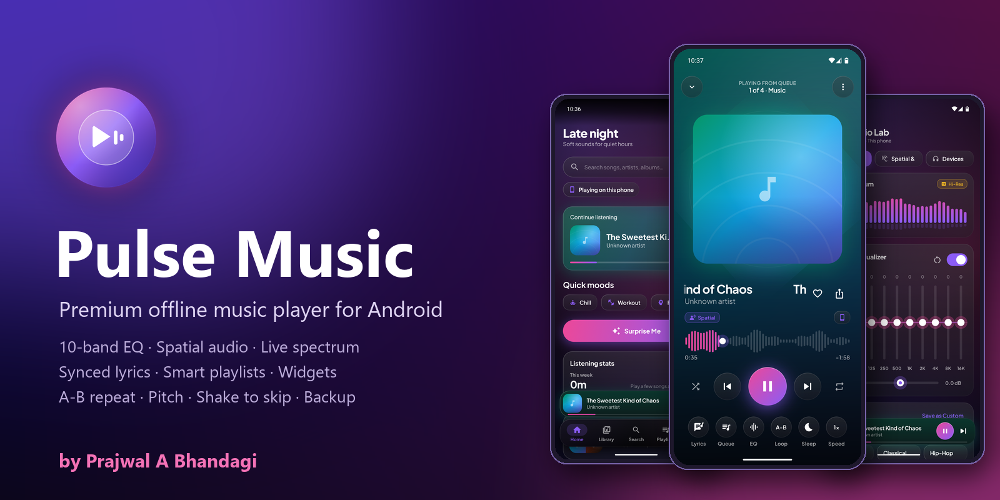


[**⬇ Download APK**](release/PulseMusic-v2.0.0.apk) · [Features](#-features) · [Screenshots](#-screenshots) · [Build](#-build-from-source)

</div>

---

## ✨ Highlights

- 🎧 **Plays the music already on your phone**: MP3, FLAC, M4A, AAC, WAV, OGG, OPUS and more. No sample tracks, no streaming, no accounts.
- 🎚️ **Audio Lab**: 10-band equalizer, 12 presets, preamp, bass boost, loudness, 3D sound stage and spatial audio.
- 📊 **Real live spectrum**: an FFT of the audio that's actually playing, with no microphone permission needed.
- 🔒 **Private by design**: no internet permission, no ads, no tracking. Your files never leave your device.

## 🚀 Features

### Playback
- Gapless playback powered by **Media3 ExoPlayer**, with background playback, notification, lock-screen and headset controls
- **A-B repeat** to loop any section of a song (great for practice and learning lyrics)
- **Speed (0.5×–2×) and pitch (±6 semitones)** control, independent of each other
- **Sleep timer** (5–90 min or end of track) with a gentle fade-out
- **Skip silence**, resume where you left off, smart queue with drag-to-reorder and swipe-to-remove
- **Shake to skip**: shake your phone twice to jump to the next song
- **Keep screen on** while the player or lyrics are open
- **Double-tap the artwork to like** a song, with a heart-burst animation

### Library
- Automatic scan of internal storage and SD cards, picking up new downloads within seconds
- Songs, Albums, Artists, Genres, Folders and Years, with sorting, grid/list views and fast-scroll index
- **Song details**: real format, average bitrate, sample rate, bit depth, size, play count and file location
- **Hide short audio** (off / 20 s / 30 s / 60 s) to keep voice notes and clips out of your library
- Clean titles for untagged files (`My_song_name.mp3` shows as "My song name")

### Playlists and discovery
- Create, rename and delete playlists; add from any song's menu or save the current queue
- Smart playlists: Liked, Most Played, Recently Added, Recently Played, Chill, Workout, Focus, Sleep
- Home feed with Continue Listening, Quick Moods, Surprise Me, Throwback mix and listening stats
- **Backup & restore** liked songs and playlists to a JSON file, then restore them on a new phone

### Audio Lab
- 10-band EQ (32 Hz–16 kHz) with presets: Flat, Rock, Pop, Jazz, Classical, Hip-Hop, EDM, Metal, Acoustic, Vocal, Bass Boost, Podcast
- Auto EQ preset by genre, plus per-device EQ profiles (speaker, wired, Bluetooth, USB DAC)
- Ear controls: left/right volume, balance, mono mode, channel swap, hearing test with compensation
- Bluetooth automation: pause on disconnect, resume on reconnect, optional autoplay

### Look and feel
- Glassmorphism UI with aurora backgrounds and artwork-tinted players
- Themes: AMOLED black, Light, Material You and Follow system, plus 6 accent colors
- Synced lyrics (`.lrc`), car mode, home-screen widgets and shareable "Now Playing" cards
- Adaptive layouts for phones, foldables and tablets, plus a Reduce Motion accessibility option

## 📱 Screenshots

| Onboarding | Home | Library | Now Playing |
|:--:|:--:|:--:|:--:|
| 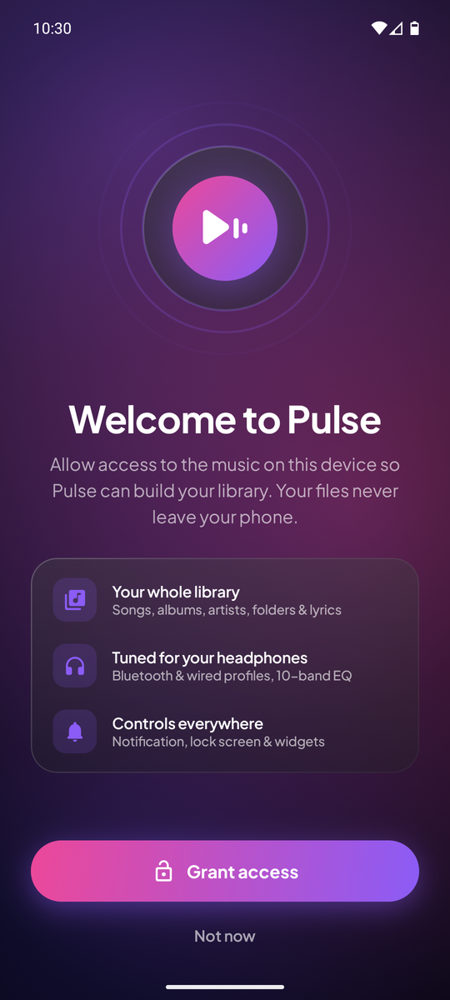 | 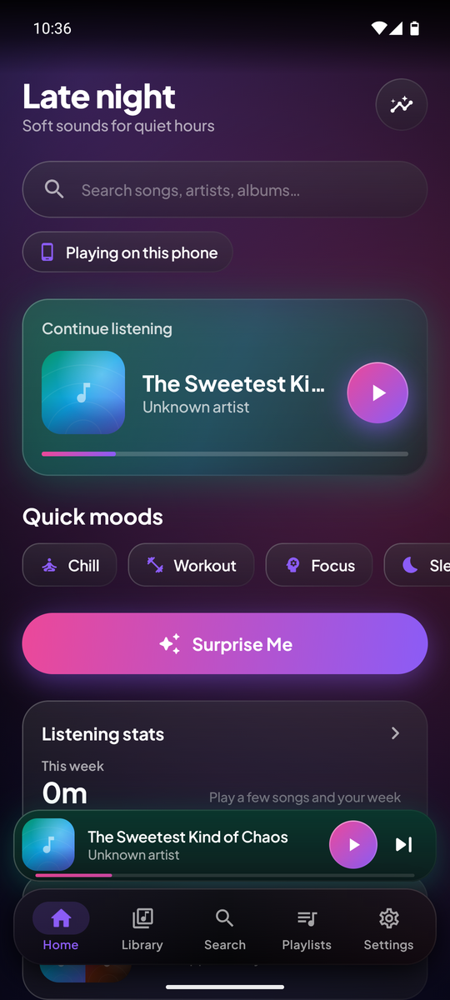 | 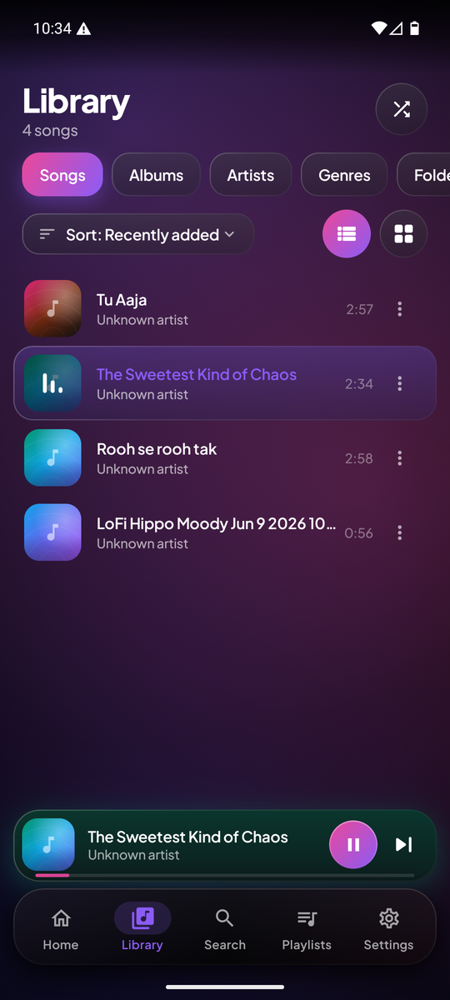 | 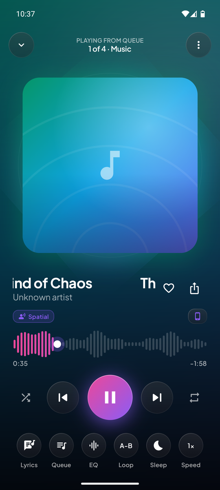 |

| Audio Lab | Sleep Timer | Playlists | Song Actions |
|:--:|:--:|:--:|:--:|
| 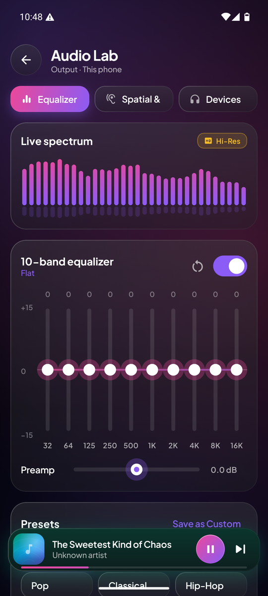 | 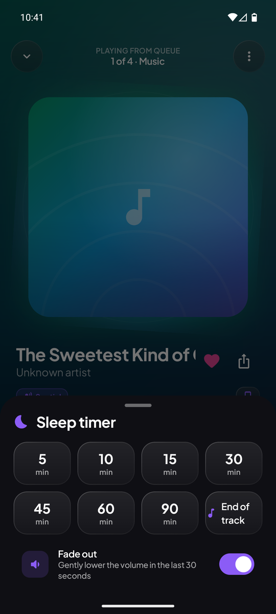 | 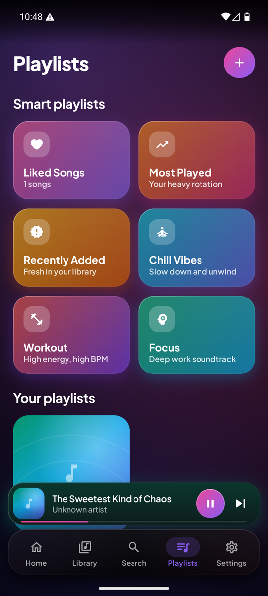 | 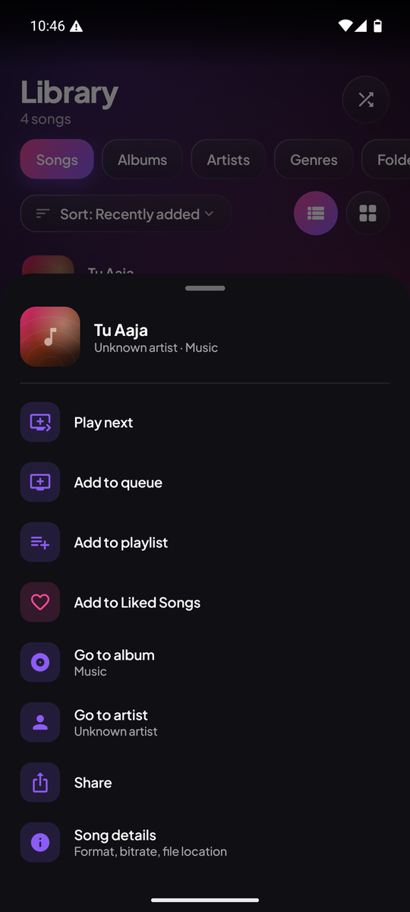 |

| Settings | Backup & Restore | About |
|:--:|:--:|:--:|
| 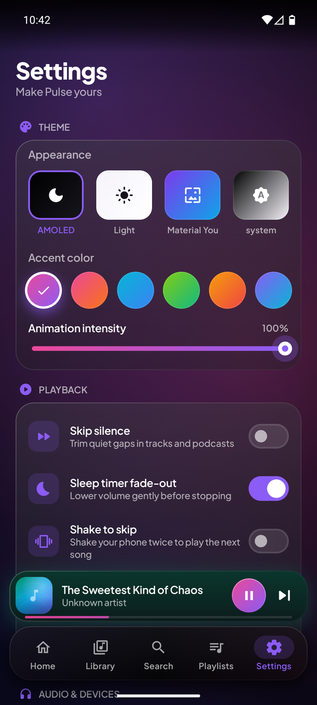 | 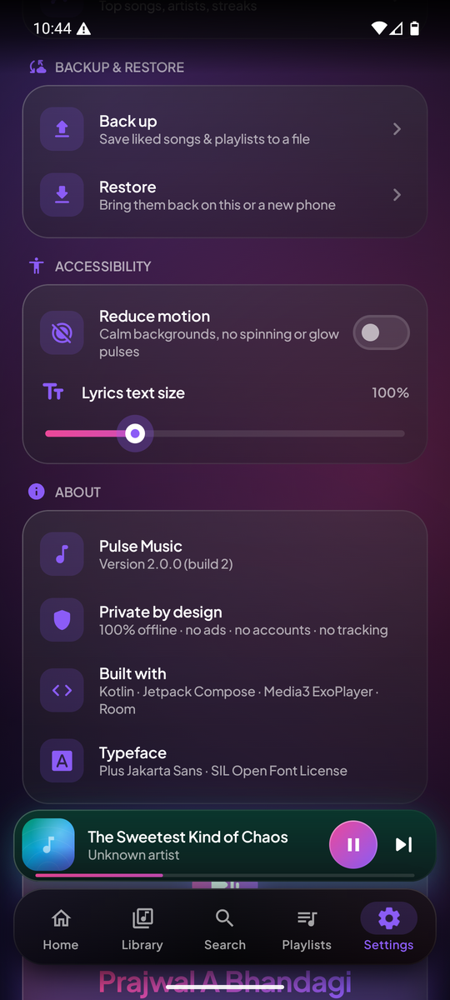 | 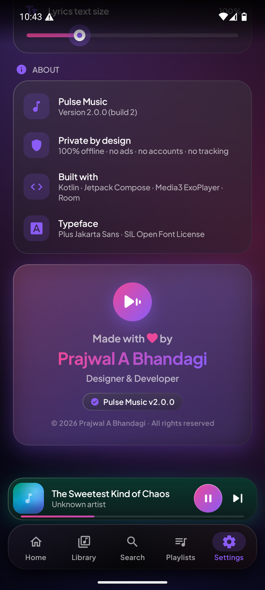 |

## 📦 Install

1. Download [`PulseMusic-v2.0.0.apk`](release/PulseMusic-v2.0.0.apk) (2.9 MB, signed release build).
2. Open it on your phone and allow **Install unknown apps** if Android asks.
3. Launch **Pulse Music**, tap **Grant access**, and your library appears.

> Requires Android 8.0 (API 26) or newer.

## 🛠 Tech stack

| Layer | Technology |
|---|---|
| Language | Kotlin 2.2 |
| UI | Jetpack Compose, Material 3 |
| Playback | AndroidX Media3 (ExoPlayer + MediaSession) |
| Storage | Room (playlists, likes, history), DataStore (settings) |
| Audio | Android Equalizer / BassBoost / Virtualizer / LoudnessEnhancer, custom PCM processor + FFT |
| Images | Coil |
| Architecture | MVVM, Kotlin Coroutines and Flow, single-activity |

```
app/src/main/java/com/example/
├── audiolab/     EQ, effects, device monitor, PCM processor, FFT spectrum analyzer
├── data/         Room DB, DataStore prefs, MediaStore scanner, backup/restore
├── lyrics/       LRC parser and loader
├── playback/     ExoPlayer manager, MediaSession service, shake detector
├── smart/        Smart playlists, mixes and listening stats
├── ui/           Compose screens, components and theme
└── widget/       Home-screen widgets
```

## 🔧 Build from source

**Requirements:** Android Studio (latest) or JDK 17+ with the Android SDK (API 36).

```bash
git clone https://github.com/prajwal032004/pulse_music.git
cd pulse_music

# Debug build
./gradlew assembleDebug

# Signed release build (minified + resource-shrunk)
./gradlew assembleRelease
```

For a release build, create `keystore.properties` in the project root (it is git-ignored):

```properties
storeFile=pulse-release.jks
storePassword=YOUR_PASSWORD
keyAlias=pulse
keyPassword=YOUR_PASSWORD
```

The APK is written to `app/build/outputs/apk/release/app-release.apk`.

## 🔐 Permissions

| Permission | Why |
|---|---|
| `READ_MEDIA_AUDIO` / `READ_EXTERNAL_STORAGE` | Find the songs on your device |
| `POST_NOTIFICATIONS` | Playback controls in the notification |
| `FOREGROUND_SERVICE_MEDIA_PLAYBACK` | Keep music playing in the background |
| `MODIFY_AUDIO_SETTINGS` | Equalizer and audio effects |

No internet permission. Pulse Music works completely offline.

## 👨‍💻 Author

<div align="center">

**Made with ❤️ by Prajwal A Bhandagi**

Designer & Developer

[](https://github.com/prajwal032004)

© 2026 Prajwal A Bhandagi. All rights reserved.

</div>
